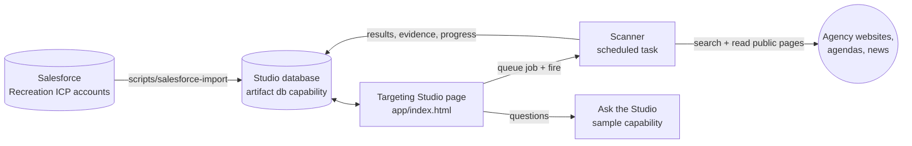

# AE Territory Analysis Tool · Targeting Studio

Targeting Studio is a one-page territory tool for a CivicPlus REC account executive. It takes every agency in the territory that runs a parks and recreation department, scores how ready each one is to buy recreation management software, lines that up against the agency's budget calendar, and tells the rep who to call, why, and when.

The territory is five states: **Texas, Pennsylvania, Rhode Island, Connecticut and South Dakota**. The agency list comes from Salesforce (the Recreation ICP flag); everything else comes from public web pages that the scanner reads and cites.

> **Status:** Version 4, November 17, 2026. Runs as a private claude.ai artifact. See [CHANGELOG.md](CHANGELOG.md).

## What the rep sees

| Area | What it does |
|---|---|
| **Headlines** | Short, state-specific headlines for the agencies most worth pursuing right now (a new recreation director, software on a council agenda, PDF-only registration in seed season). The **All Five** tab shows the top headlines from each state. |
| **Funnel** | Swept → screened in → scanned → with signals → shortlisted, per state, each step clickable into the list behind it. |
| **Readiness score** | 0–100 from four dimensions: Fit 30, Friction 25, Timing 30, Access 15. Unknown facts score zero, so a score only rises as evidence comes in. |
| **Tiers** | Tier 1 needs Readiness 75+ **and** a live trigger or an open budget seed window, then a deep scan, then the rep's check. "Near the line" flags agencies within 10 points of Tier 1. |
| **Budget timing** | Each state has a default fiscal calendar with a source; a deep scan replaces it with the agency's own verified calendar. The seed window opens four months before budget prep. |
| **Scans** | *General scan* (one state at a time, light, about 30 seconds per agency) and *deep scan* (one agency, six steps). A live radar, a progress bar and a per-agency log show the scan as it runs. |
| **Ask the Studio** | A chat panel that answers from the Studio's own data and can open agencies, filter lists and queue scans (the rep confirms). |
| **Charts** | Proportional funnel, Readiness strip with tier lines, registration landscape by state, 12-month seed-window timeline. |
| **Agency drawer** | Every score factor with its evidence link, signals, contacts, budget calendar, set-aside controls and notes. |
| **Export** | CSV of the current list with tier, readiness, signals, friction, budget window and evidence URLs. |

Existing REC customers are set aside automatically. Competitor platforms are **never** a reason to set an agency aside; they are shown as information.

## How it works



1. **Import.** A one-time (refreshable) Salesforce pull builds the base dataset: agencies flagged for Recreation ICP, population 5,000–75,000, deduplicated, non-recreation governments removed, with customer status, contact counts and nearest REC customer. See [docs/data-import.md](docs/data-import.md).
2. **Scan.** The page writes a scan job to its database and fires a scheduled task. The task follows [scanner/runbook.md](scanner/runbook.md), reads only public pages, and writes findings with a source URL for each one. See [docs/scanning.md](docs/scanning.md).
3. **Score.** The page merges scan results over the base record and scores each agency in the browser. Weights and points are editable in Settings. See [docs/scoring.md](docs/scoring.md).

## Repository layout

```
app/index.html                    The Studio page (single file: markup, styles, script)
scanner/runbook.md                Prompt for the scanner scheduled task
scripts/salesforce-import/        Rebuild the base dataset from Salesforce exports
  build.py  chunk.py  parse.py  README.md
docs/
  architecture.md                 Runtime, data model, page modules
  scoring.md                      Readiness, tiers, priority, budget windows
  scanning.md                     General vs deep scan, job lifecycle
  data-import.md                  Salesforce rules and cleanup
CHANGELOG.md
```

No CRM data, scan results or credentials live in this repository. The Salesforce exports and the generated dataset stay in the Studio's database and in a git-ignored `input/` and `out/` folder.

## Running it

The page is written for the claude.ai artifact runtime, not as a stand-alone website. It needs these runtime capabilities:

| Capability | Used for |
|---|---|
| `db` | Base dataset, scan results, rep decisions, settings, scan jobs |
| `downloads` | CSV export |
| `sample` | Ask the Studio chat (page tools: search, get, open, show list, queue scan, state overview) |
| `mcp` → `Claude Code Remote` · `fire_trigger` | Starting the scanner when a scan button is pressed |

To stand up a fresh copy:

1. Publish `app/index.html` as an artifact with the four capabilities above.
2. Create a scheduled task (fire-only, no schedule) whose prompt is [scanner/runbook.md](scanner/runbook.md) with `<STUDIO_ARTIFACT_URL>` replaced by the new artifact's link.
3. Write `config/scanner` in the artifact database: `{triggerId, name, connector: "Claude Code Remote", tool: "fire_trigger"}`.
4. Run the Salesforce import and load `states/{ST}/base/c{n}` and `summary/{ST}` (see [scripts/salesforce-import/README.md](scripts/salesforce-import/README.md)).
5. Open the page. Settings (`settings/current`) is created with the defaults on first save.

Opened directly from disk, the page loads but has no database, scanner or chat, so it shows an empty Studio.

## Data rules

- Scanned values come only from public pages read during that scan; anything not seen is recorded as `unknown`, never guessed.
- Every finding carries its source URL and a short excerpt, and stays `verified: false` until the rep checks it.
- No LinkedIn. Short quotes only; everything else is paraphrased.
- Unverified signals count at half weight until the rep verifies them.

## Roadmap

- ADA deadline as a built-in timing trigger.
- Territory dot map.
- Pricing table (Priority switches from relative to dollars once set).
