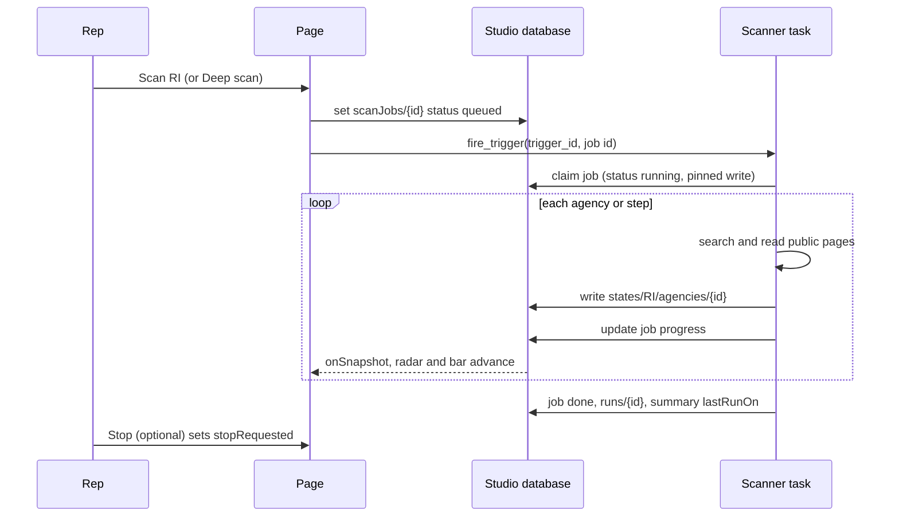

# Architecture

Targeting Studio is one HTML file (`app/index.html`, about 240 KB) with its markup, styles and script inline. It loads no external libraries; charts, the radar and the chat panel are hand-built SVG and DOM. It runs inside the claude.ai artifact viewer, which grants it runtime capabilities, and it shares one database with a scheduled task (the scanner) that does the web research.

## Runtime capabilities

| Capability | How the page uses it | Without it |
|---|---|---|
| `db` | Reads the base dataset, scan results, settings, budget defaults, summaries, sweeps and scan jobs with live `onSnapshot` subscriptions; writes rep decisions, settings, weight versions, score snapshots and scan jobs. | Empty Studio with a notice. |
| `downloads` | `downloads.save()` for the CSV export, after the viewer confirms. | The CSV is shown in a box to copy. |
| `sample` | Ask the Studio: `sample(messages, {tools, modelTier: 'quick'})` with page tools. | The chat says it isn't available in this view. |
| `mcp` | `callTool('Claude Code Remote', 'fire_trigger', {trigger_id, text})` to start the scanner. | The job still queues; the console offers a line to paste into a chat with Claude ("Process Targeting Studio scan job …") and a Try again button. |

Every capability is optional: the page asks for it with `await claude.use(name)` and falls back as above when the answer is `null`.

## Database layout

| Path | Written by | Contents |
|---|---|---|
| `states/{ST}/base/c{n}` | Import | `{state, source, importedOn, chunk, rows[]}`, about 150 agencies per document |
| `states/{ST}/agencies/{id}` | Scanner | Scan results for one agency, layered over its base row |
| `states/{ST}/decisions/{id}` | Page | Rep verification, set-aside, manual fields, notes. The scanner never writes here. |
| `scanJobs/{id}` | Page, then scanner | Job definition, status and live progress |
| `sweeps/{ST}` | Scanner | State sweep results (software bids, grant awards, director openings) |
| `runs/{id}` | Scanner, import | Run log: scope, counts, failures, blocked sites |
| `summary/{ST}` | Import, scanner | Import counts and `lastRunOn` |
| `config/scanner` | Setup | `{triggerId, name, connector, tool}` |
| `settings/current` | Page | Weights, tiers, population range, points table, bands, months |
| `stateBudgetDefaults/{ST}` | Page | Default fiscal calendar per state with its source |
| `weightVersions/v{n}`, `scoreSnapshots/{ST}` | Page | Saved weight sets and the scores they produced |

### Layering

A record on screen is `mergeAgency(baseRow, scanOverlay)` plus the rep's decision:

- Top-level fields: the overlay wins.
- `friction`, `budget`, `recFunction`, `relationship`, `salesforce`, `nearby`: shallow merge, overlay keys win.
- `evidence`, `signals`: appended and de-duplicated on field or type, URL and date.
- `decisions/{id}` sits on top for anything the rep sets by hand (`manual.*`, `setAside`, `verified`, `forceInclude`).

This keeps the import, the scanner and the rep from overwriting each other.

### Agency record (abridged)

```js
{
  id: "pa-township-example", name, state, type, population, website, city,
  recFunction: { status: "yes", basis: "Salesforce Recreation ICP", core, capacity },
  relationship: { status: "existing" | "new_logo", products[], ownsREC, contactKnown, contactCount, notSuitableOutbound },
  friction: { registration, platformDetected, competitor, incumbentQuality, payment, booking, accessibility, programBreadth[] },
  budget: { fyStartMonth, prepStartMonth, prepEndMonth, adoptionStartMonth, adoptionEndMonth, basis, sourceUrl },
  signals: [{ type, date, summary, sourceUrl, capturedOn, confidence, verified }],
  evidence: [{ field, url, capturedOn, excerpt, confidence, verified }],
  contacts: [{ role, name, level, sourceUrl }],
  geo: [lat, lon], neighbors: [ids within 20 miles], nearby: { recCustomer: { name, miles } },
  stage, scanLevel, lastScannedOn, deepScannedOn, deepSummary, incumbent
}
```

## Page modules

The script is organized in sections, top to bottom:

| Section | Key functions |
|---|---|
| Constants | `TYPES`, `PROGRAMS`, `REASONS`, `DEEP_STEPS`, `BUDGET_DEFAULTS`, `DEFAULTS`, `FACTORS`, `PRESETS` |
| Scoring | `computeMaxes`, `budgetFor`, `windowAt`, `seasonalFor`, `derive`, `readinessWith`, `priorityWith` |
| Data | `connect`, `subscribeDecisions`, `ensureRows`, `mergeAgency`, `refreshAgency`, `writeDoc` |
| Scan engine | `nextBatch`, `sweepDue`, `createJob`, `fireScanner`, `startGeneral`, `startDeep`, `stopJob`, `onJobs` |
| Radar and console | `radarDots`, `mountRadar`, `radarFrame`, `consoleHTML`, `renderConsole` |
| Charts | `funnelChart`, `readinessChart`, `registrationChart`, `timelineChart` |
| Chat | `CHAT_TOOLS`, `chatRules`, `chatSend`, `renderChat`, `mdLite` |
| Headlines | `shortName`, `SIG_HEAD`, `SIG_W`, `headlineFor`, `headlinesFor`, `headlinesHTML` |
| Views | top bar, state tabs, funnel, list, drawer, settings, CSV export |

All scoring runs in the browser on every render from the merged records, so a change to weights or points re-ranks the territory instantly.

## Scan lifecycle



## Theme

Dark, single theme (`color-scheme: dark`). Colors are CSS tokens at the top of the stylesheet: background `#070B14`, surface `#0D1424`, radar red `#FF3D3D`, and one hue per score dimension (Fit `#2FC79A`, Friction `#FF8A3D`, Timing `#5B9BFF`, Access `#A6B1C6`). Official CivicPlus brand codes can be dropped into the tokens. The layout keeps a 16px safe-area gutter and works at phone width.

## Testing approach

Versions were checked in headless Chromium with Playwright against a stub of the runtime (a `localStorage`-backed `db` with `onSnapshot`, plus stubbed `mcp`, `sample` and `downloads`): funnel counts equal their lists, weight changes re-rank, decisions survive reload, CSV columns match, no horizontal overflow at 390px, and the radar and progress bar follow a job's progress. The live scanner was verified end to end on three Rhode Island agencies, with findings checked against the source pages.
